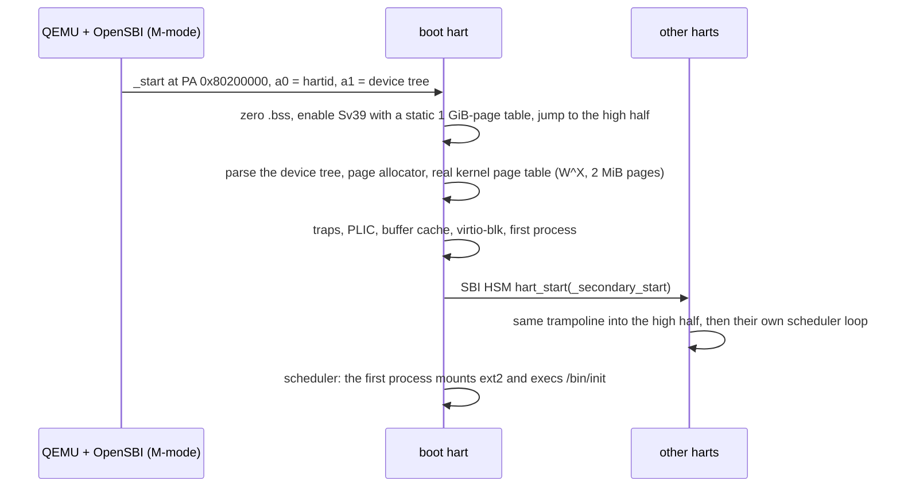

# kiln

[](https://github.com/pMag11-alt/kiln/actions/workflows/ci.yml)

A small Unix-like kernel for 64-bit RISC-V, written from scratch in C. It boots
on QEMU's `virt` board under OpenSBI, schedules processes across up to 8
harts, and keeps its files on a real **ext2** file system: the test suite runs
Linux's own `e2fsck` on the disk image after every boot and reads kiln's
files back with `debugfs`.

```
kiln: RISC-V kernel, 128 MiB RAM, 4 harts, SBI v3.0, booting on hart 1
virtio-blk: 64 MiB at 0x10001000, irq 1
ext2: 65536 x 1024-byte blocks (62061 free), 4096 inodes (4037 free), 8 groups

kiln:/$ ls -l /home /dev
/home:
-rw-r--r--  1       91 Oct 25 2026 15:59 hello.txt

/dev:
crw-rw-rw-  1   5,   1 Oct 25 2026 console
crw-rw-rw-  1   1,   3 Oct 25 2026 null
crw-rw-rw-  1   1,   5 Oct 25 2026 zero
kiln:/$ echo "kiln was here" > /home/note.txt; cat /home/*.txt | wc -l
      3
kiln:/$ primes 50 | sort -rn | head -n 3
47
43
41
kiln:/$ ps
  PID  PPID  PGID S CPU  MEM(K)   TIME NAME
    1     0     1 S   -      16   0:00 init
    2     1     2 S   -      48   0:00 sh
   26     2    26 R   0      16   0:00 ps
kiln:/$ free
memory:    128268 KiB total     1212 KiB used   127056 KiB free
faults:       122 copy-on-write        9 demand-zero
disk:         126 reads         35 writes   cache 171 hits / 126 misses
kernel:       704 syscalls      238 context switches
kiln:/$ sh -c "kill -SEGV \$\$"; echo "exit status $?"
Segmentation fault
exit status 139
kiln:/$ shutdown
kiln: powering off
```

## What's in it

**Kernel** (about 5,200 lines of C and assembly)

- **Boots like a real OS.** kiln runs in S-mode on top of OpenSBI and talks to
  it through the SBI: TIME for the scheduler tick, HSM to start the other
  harts, SRST to power off. RAM, harts, the UART, the PLIC, the RTC and the
  virtio slots all come from the device tree. Nothing about the board is
  hard-coded.
- **Higher-half kernel, no trampoline.** All of physical memory is
  direct-mapped at `0xFFFFFFC000000000`, and the kernel half is shared by
  every page table. A trap from user mode enters the kernel without touching
  `satp`, so a system call costs no TLB flush. `sscratch` tells the single
  trap vector which mode it came from (see [Traps](#traps-without-a-trampoline)).
- **Virtual memory.** Sv39 with W^X everywhere: kernel text is R+X, data is
  R+W, and ELF segments asking for W+X are rejected. Pages 0–15 stay unmapped
  to catch NULL. Kernel stacks sit above unmapped guard pages.
- **Copy-on-write `fork`** with per-page reference counts. A forked child
  shares every page until one side writes. A **demand-zero heap**: `sbrk`
  only moves the break, and pages appear on first touch. A **stack that
  grows on demand** up to 1 MiB.
- **SMP.** A scheduler loop per hart, spinlocks that disable interrupts,
  sleeplocks for disk I/O, and preemption at 100 Hz, in kernel mode too.
  Tested on 1, 4 and 8 harts.
- **ext2, read and write.** Direct, single, double and triple indirect
  blocks, sparse files, hard links, `rename` (directories across parents
  included), `ftruncate`, device nodes and unlink-while-open. Images come
  from `mke2fs -d` and stay clean under `e2fsck`.
- **Drivers.** A modern virtio-blk (MMIO) driver with interrupt completion
  and several requests in flight, an NS16550 UART with a canonical line
  discipline (backspace, `^U`, `^D`, `^C`, plus `^P` for a process dump), and
  the goldfish RTC for wall-clock time.
- **A Unix process model.** `fork`/`execve`/`waitpid` with POSIX wait
  statuses, process groups, `kill` with signal numbers, `SIGPIPE`, `^C` sent
  to the foreground process group, orphans re-parented to init, and errno
  values that match Linux.
- **37 system calls.** See [`include/kiln/abi.h`](include/kiln/abi.h).

**User space** (about 3,500 lines)

- A small libc: syscall stubs that set `errno`, `printf`, `malloc`/`free`
  with coalescing, `opendir`/`readdir`, `qsort` and `strerror`.
- **`sh`**: pipelines, `<`, `>`, `>>`, `2>`, `2>&1`, `&&`, `||`, `;`,
  background jobs with `&`, `wait` and `jobs`, single and double quotes,
  backslash escapes, `*`/`?` globbing, `$?` and `$$`. `^C` kills the
  foreground job and leaves the shell running. Crashes are reported as
  "Segmentation fault" and the like. Scripts run with `sh file` or
  `sh -c '...'`.
- **35 programs**: `ls -la`, `cat`, `grep` (regular expressions), `sort`,
  `uniq`, `wc`, `head`, `tail`, `tee`, `cp`, `mv`, `rm -r`, `ln`,
  `mkdir -p`, `touch`, `stat`, `ps`, `kill`, `free`, `df`, `uptime`,
  `date`, `hexdump`, `crc32`, `seq`, `yes`, `primes` (McIlroy's concurrent
  sieve, one process per prime), `shutdown` and more.

## Testing

`make test` boots the system twice under QEMU on a scratch copy of the disk
and checks three layers:

1. **[`usertests`](user/usertests.c)**: 32 kernel tests that run inside the
   guest, each in its own process. They cover fork/wait/exit statuses,
   filling the process table, re-parenting, signals and process groups, exec
   errors (`ENOENT`, `EACCES`, `ENOEXEC`, `E2BIG`), lazy `sbrk`, COW
   semantics and COW memory accounting, stack growth and overflow, NULL /
   text-write / kernel-address / illegal-instruction / FPU / execute-heap
   faults, bad user pointers handed to syscalls, pipe integrity under
   wrap-around and many writers, `EPIPE`/`SIGPIPE`, big files that need
   double-indirect blocks, sparse files, truncation, unlink-while-open, hard
   links, directory edge cases, 400-entry directories, every `rename` case,
   `dup`/`dup2`/`EMFILE`, concurrent writers and `O_APPEND`, scheduling on
   several harts, and running out of memory.
   **After every test the runner checks that free memory pages, free disk
   blocks and free inodes are exactly what they were before.** Any leaked
   page table, COW page, indirect block or inode fails the test.
2. **The shell and tools**: about 40 command lines with exact expected
   output, background jobs, `^C` on a running job and at an empty prompt,
   and crash reporting.
3. **Interoperability with Linux's ext2 tools.** kiln checksums a file that
   `mke2fs` wrote (the kernel ELF, big enough for double-indirect blocks),
   then writes files, hard links and renames. After power-off, `e2fsck -fn`
   must find nothing to fix, and `debugfs` must read kiln's files
   byte-for-byte. The host then adds a file with `debugfs -w`. On the second
   boot kiln must read it, find its own files intact, and delete some; after
   that `e2fsck` runs again.

```
test fork_wait          ok     5 ms
test fork_exhaust       ok    12 ms
test cow_sharing        ok    47 ms
test faults             ok     2 ms
test file_big           ok  4801 ms
test dir_many           ok  3864 ms
test rename             ok    71 ms
test smp                ok   502 ms
test oom                kiln: pid 220 (usertests) killed: out of memory
ok   351 ms
ALL 32 TESTS PASSED in 14036 ms
...
  ok   boot 1: e2fsck -fn reports a clean file system
  ok   debugfs reads a 380 KB file kiln wrote
  ok   boot 2: e2fsck -fn reports a clean file system
all system tests passed
```

CI runs the whole thing on Ubuntu with 1 and 4 harts and on macOS.

## Building and running

You need clang and lld (LLVM 17 or newer), QEMU 7 or newer, e2fsprogs and
Python 3.

```bash
brew install llvm lld qemu e2fsprogs                                   # macOS
sudo apt install clang lld llvm qemu-system-misc opensbi e2fsprogs     # Debian/Ubuntu
```

```bash
make qemu        # build everything and boot; Ctrl-A X quits QEMU
make test        # the full test run described above
make qemu CPUS=8 # more harts (default 4)
make fresh       # rebuild the disk image (it persists between boots)
make qemu-gdb    # wait for gdb on tcp::1234
make fsck        # e2fsck the disk image
```

A kernel panic prints a frame-pointer backtrace;
`make addr2line ADDRS="0xffffffc0802059ce ..."` turns it into file:line.

## How it works

### Boot



The kernel is linked at `KERNBASE + 0x80200000` but starts at the physical
address with the MMU off. [`entry.S`](kernel/entry.S) uses only PC-relative
addressing until it has switched on a static page table. That table maps RAM
both at its physical address (for the instruction right after the `satp`
write) and in the high half. Once running high, `kvminit` builds the real
table and the identity map disappears.

### Address space

| Virtual address | Contents |
|---|---|
| `0x0000000000000000` | unmapped (NULL guard, 64 KiB) |
| `0x0000000000010000` | program text (R+X), then data and bss (R+W) |
| above the image | heap: grows with `sbrk`, pages faulted in on first touch |
| `0x0000003FFFEFF000`–`0x0000003FFFFFF000` | user stack, grows down on demand to 1 MiB |
| `0xFFFFFFC000000000` | direct map of physical memory (kernel only) |
| `0xFFFFFFC080200000` | the kernel image |
| `0xFFFFFFD000000000` | kernel stacks, 16 KiB each above an unmapped guard page |

### Traps without a trampoline

Because the kernel half is present in every page table, one `stvec` handles
traps from both modes. The trick is `sscratch`: in user mode it holds a
pointer to the current process's trap frame, and in kernel mode it holds
zero. The first instruction of [`trap.S`](kernel/trap.S) swaps it with `tp`:

```asm
trap_vector:
    csrrw   tp, sscratch, tp     # tp = trap frame (from user) or 0 (from kernel)
    bnez    tp, .Lfrom_user
```

From user mode, all 31 registers go into the trap frame, the trap frame
supplies the kernel stack and the hart's `struct cpu`, and C takes over. From
kernel mode, caller-saved registers go on the current stack, and a fake frame
record makes backtraces walk through the interrupted function.

### Copy-on-write and demand paging

`fork` copies page tables, not pages. Each writable page loses `PTE_W` in
both parent and child and gains the software bit `PTE_COW`; its reference
count goes up. On a store fault, if the page is still shared, the faulting
process gets a private copy. If it is the last sharer, the page simply
becomes writable again. Heap and stack pages that were never touched have no
PTE at all, and the fault handler maps a zero page if the address lies in
`[heap_base, brk)` or the stack window. Kernel code that touches user memory
(`copyin`/`copyout`) walks the page table in software and takes the same
paths. A `read()` into a COW or never-touched page therefore behaves exactly
like a user store, and a `read()` into the text segment fails with `EFAULT`.
When a process runs out of memory, the kernel kills it with `SIGKILL` and
reclaims every page.

### ext2

[`ext2.c`](kernel/ext2.c) is a revision-1 ext2 driver over a write-through
buffer cache. It handles block and inode bitmaps, group descriptors and
superblock counters (kept exact, because `e2fsck` checks them), the
`i_blocks` accounting including indirect blocks, `rec_len` slack reuse and
merging in directories, and `..` and link-count fix-ups when `rename` moves a
directory. `getdents` revalidates its position against the start of the
block, so deleting entries between two calls can't make it read garbage.
Files are created with Linux's `mke2fs -t ext2 -b 1024 -I 128 -O
none,filetype,sparse_super -d build/root`.

## Layout

```
kernel/        entry.S trap.S main.c        boot, trap vector, context switch
               fdt.c sbi.c plic.c uart.c console.c rtc.c virtio_blk.c
               kalloc.c vm.c                pages, page tables, COW, faults
               proc.c trap.c syscall.c sysproc.c exec.c
               bio.c ext2.c file.c pipe.c sysfile.c
include/kiln/  abi.h                        syscall numbers, errno, structs (shared)
lib/           string.c fmt.c               freestanding libc core (shared)
user/          sh.c init.c usertests.c ...  programs; user/lib/ is the libc
rootfs/        files copied into the image
scripts/       test.py qemu.py              the QEMU test harness
```

## Limitations

- Signals only terminate; there are no handlers.
- User programs can't use the FPU. `sstatus.FS` stays off, so a
  floating-point instruction raises `SIGILL`, and the kernel never saves FP
  state.
- There's no journal. A crash during a write can leave work for `fsck`. A
  clean `shutdown` always leaves the image consistent.
- Each process has a single thread, and there's no `mmap`.
- Inodes are 128 bytes (classic ext2), so timestamps end in 2038.
- There's one user and no permission checks, and no networking.

## License

MIT
